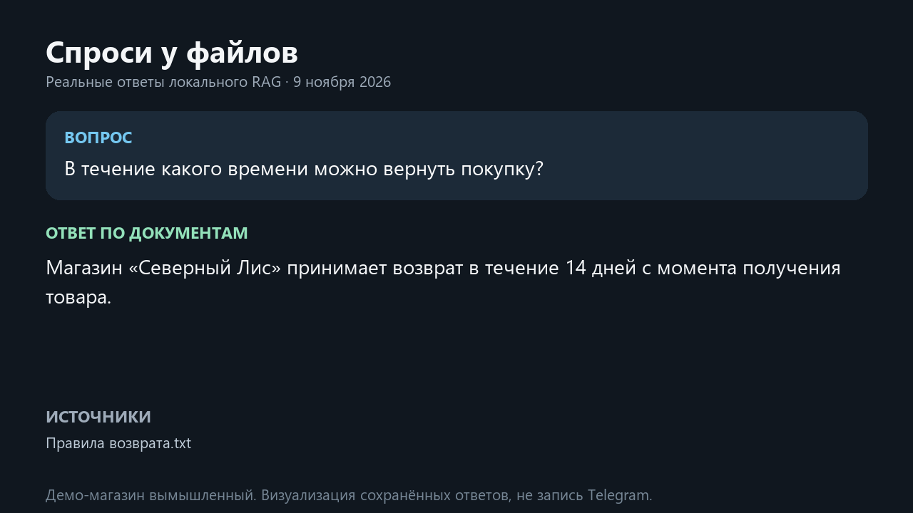

# Спроси у файлов

Telegram-бот отвечает по базе знаний вымышленного магазина и по загруженным PDF/TXT.
Ответы содержат ссылки на фрагменты. Уточняющие вопросы используют историю диалога.

```text
PDF/TXT → извлечение → фрагменты → эмбеддинги → Supabase PostgreSQL
вопрос + история → поисковый запрос → pgvector + FTS → RRF → ответ и цитаты
```



Локальное видеодемо: `data/demo.mp4` (30 с, ответы из последнего реального прогона эвалов;
визуализация результатов, не запись интерфейса Telegram). Видео и подробные прогоны
не входят в Git. `python -m evals.run_eval` сохраняет ответы каждого кейса в
`evals/runs/latest.json`.

## Запуск

1. Создай отдельную базу Neon PostgreSQL (или Supabase) и включи расширение `vector`.
2. Скопируй `.env.example` в `.env`. Укажи токен Telegram, ключ OpenRouter и
   `DATABASE_URL` для прямого подключения или Supabase Session pooler с SSL
   (`?ssl=require`). Используй Session pooler, если среда не поддерживает IPv6.
3. Установи зависимости командой `python -m pip install -r requirements.txt`.
4. Примени `alembic upgrade head`, затем запусти `python demo.py`.
5. Запусти `python bot.py` или `docker compose up --build`. Держи одну реплику polling.
   Для Amvera перенеси переменные в секреты и запускай с подготовленной базой.

Ответы генерируются через OpenRouter Free. При сбое генерации бот показывает
источники, найденные поиском. Эмбеддинги строятся локально
многоязычной моделью MiniLM (FastEmbed); при первом запуске скачиваются её веса.

## Проверки

- `python -m pip install -r requirements-dev.txt`, затем `ruff check .` и `python -m pytest`.
- Для интеграционных тестов укажи `RAG_TEST_DATABASE_URL` отдельной тестовой базы
  PostgreSQL с pgvector. Примени миграции к ней до прогона.
- `python -m evals.run_eval` сравнивает три режима поиска и проверяет ответы и цитаты.

## Паспорт

- [x] Docker, Compose, конфиг Amvera и CI на Ruff + pytest
- [x] Тесты ядра, сценарий интеграционного теста и набор эвалов
- [x] Пример окружения, структурные логи и опциональный Sentry
- [x] Фактические метрики эвалов с моделью — [результаты 09.11.2026](evals/RESULTS.md)
- [x] Локальный бот [@rag192bot](https://t.me/rag192bot) и видеодемо реальных ответов
- [ ] Постоянное размещение на Render Free + Neon: конфиги готовы, облачный запуск ожидает доступов

История ограничена шестью парами реплик на режим. После удаления документа
бот очищает историю режима файлов. Старые сообщения в самом Telegram остаются
в чате. Суточный лимит демо сбрасывается по времени Иркутска.

Локальная база для проверки может работать через PGlite с pgvector и TCP-сокетом.
Для неё нужен `PGLITE_LOCAL=1`. Для размещения используй обычный PostgreSQL.

## Бесплатный хостинг

`render.yaml` описывает бесплатный Docker-сервис Render по схеме Документ-хелпера
и «Глянца». Telegram обращается к вебхуку и будит сервис после простоя. Данные
хранятся во внешнем PostgreSQL с pgvector, например в Neon Free. Для Blueprint
нужны `BOT_TOKEN`, `DATABASE_URL` и `OPENROUTER_API_KEY` в секретах Render.
`WEBHOOK_SECRET` генерирует Render. При старте применяются миграции и
добавляются демо-документы. Перед запуском вебхука останови локальный polling.

